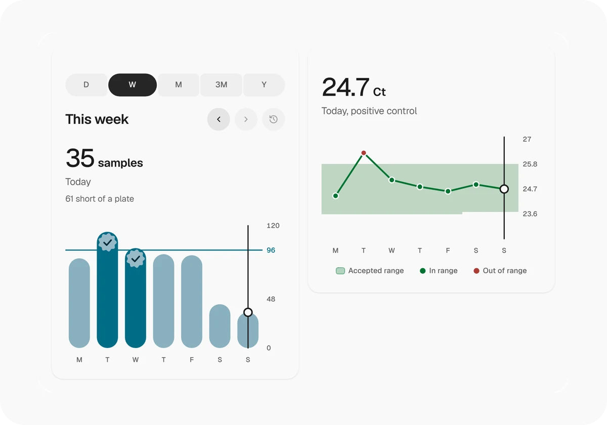
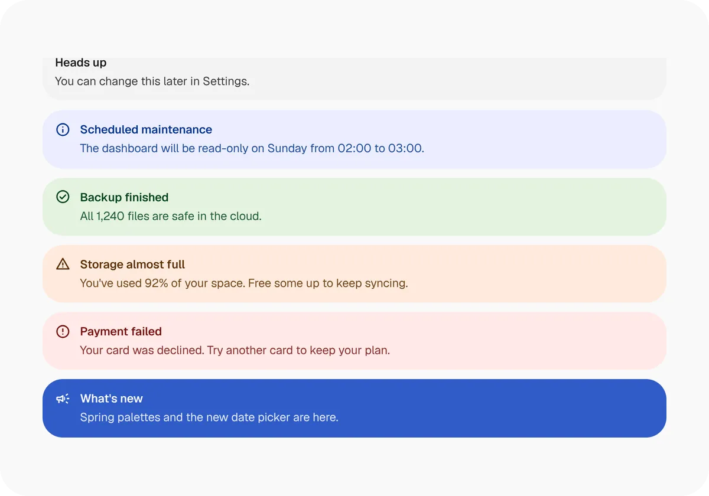
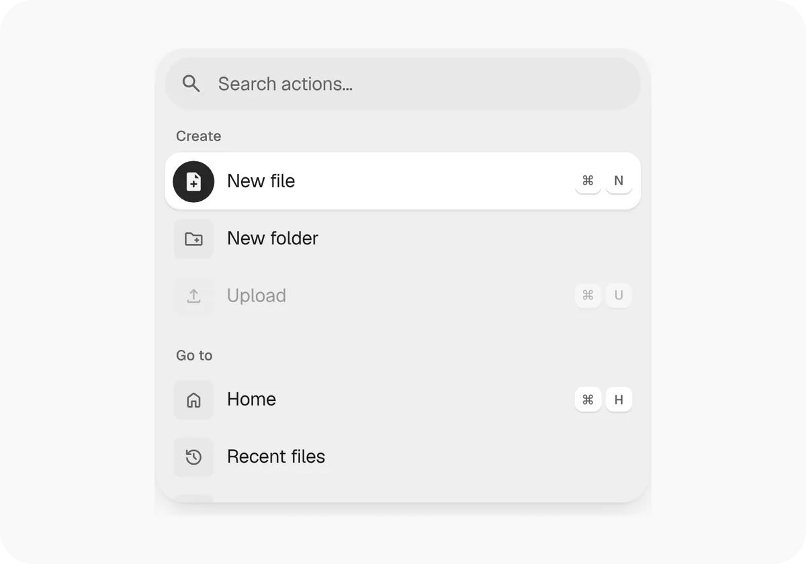
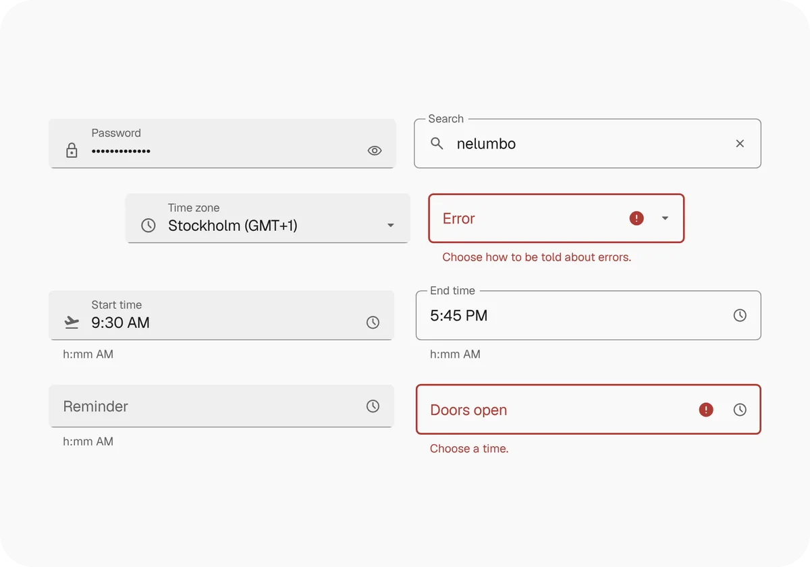
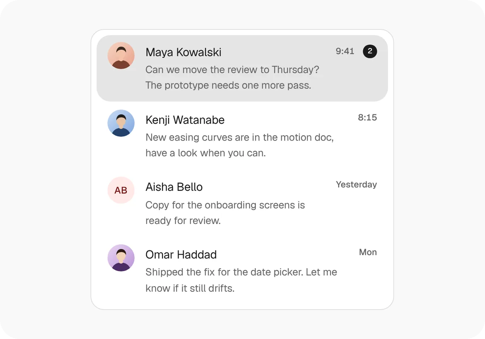
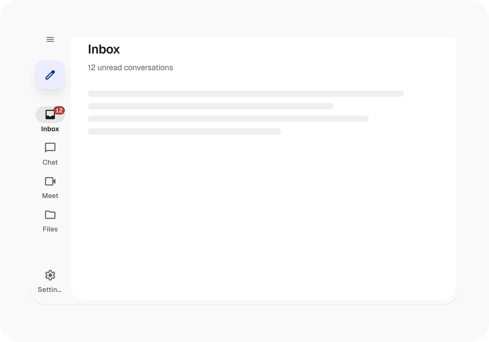
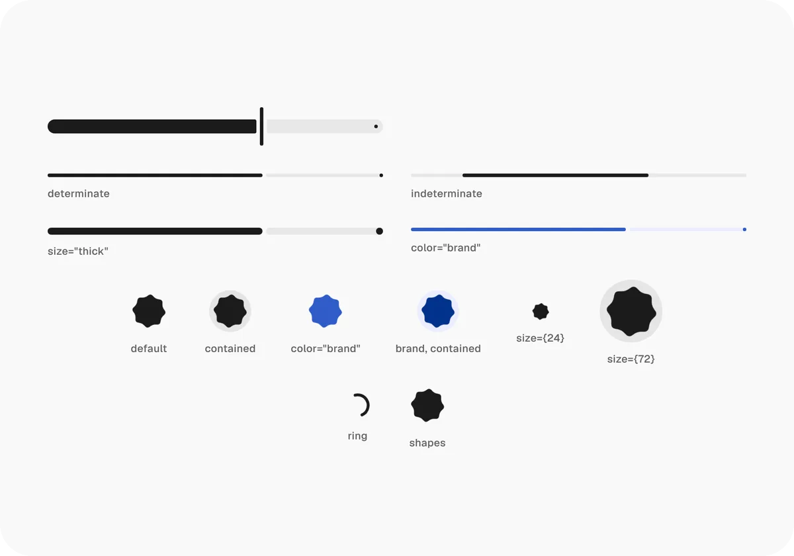
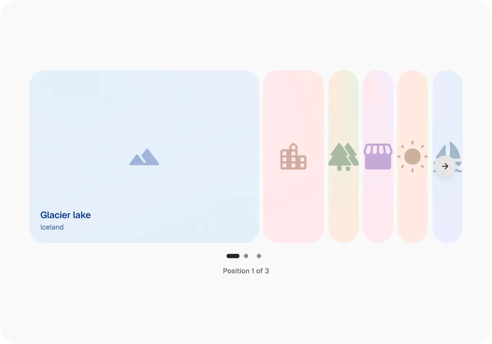

<p align="center"></p>

# Nelumbo

A soft, tactile design system for shadcn/ui (Tailwind v4). Neutral first: the
interface is black, white and true grays, with depth from a surface ladder,
two-layer shadows and spring motion. Color comes from an accent
palette (blue, cyan, green, amber, orange, red, pink, purple) used where it
means something: status, categories, charts and focus. One accent is the brand.

## Components

<table>
<tr>
<td width="50%"><picture><source media="(prefers-color-scheme: dark)" srcset="docs/components/charts-dark.webp"></picture><br><sub>Charts</sub></td>
<td width="50%"><picture><source media="(prefers-color-scheme: dark)" srcset="docs/components/buttons-dark.webp"></picture><br><sub>Buttons, split buttons, segmented buttons, FABs</sub></td>
</tr>
<tr>
<td width="50%"><picture><source media="(prefers-color-scheme: dark)" srcset="docs/components/alerts-dark.webp"></picture><br><sub>Alerts</sub></td>
<td width="50%"><picture><source media="(prefers-color-scheme: dark)" srcset="docs/components/command-dark.webp"></picture><br><sub>Command palette</sub></td>
</tr>
<tr>
<td width="50%"><picture><source media="(prefers-color-scheme: dark)" srcset="docs/components/date-picker-dark.webp"></picture><br><sub>Date picker</sub></td>
<td width="50%"><picture><source media="(prefers-color-scheme: dark)" srcset="docs/components/data-table-dark.webp"></picture><br><sub>Data table</sub></td>
</tr>
<tr>
<td width="50%"><picture><source media="(prefers-color-scheme: dark)" srcset="docs/components/fields-dark.webp"></picture><br><sub>Inputs, selects, time fields</sub></td>
<td width="50%"><picture><source media="(prefers-color-scheme: dark)" srcset="docs/components/list-dark.webp"></picture><br><sub>List</sub></td>
</tr>
<tr>
<td width="50%"><picture><source media="(prefers-color-scheme: dark)" srcset="docs/components/phones-dark.webp"></picture><br><sub>Navigation bar, FAB menu</sub></td>
<td width="50%"><picture><source media="(prefers-color-scheme: dark)" srcset="docs/components/navigation-rail-dark.webp"></picture><br><sub>Navigation rail</sub></td>
</tr>
<tr>
<td width="50%"><picture><source media="(prefers-color-scheme: dark)" srcset="docs/components/selection-dark.webp"></picture><br><sub>Switches, checkboxes, chips, sliders</sub></td>
<td width="50%"><picture><source media="(prefers-color-scheme: dark)" srcset="docs/components/progress-dark.webp"></picture><br><sub>Progress, loading indicators, spinners</sub></td>
</tr>
<tr>
<td width="50%"><picture><source media="(prefers-color-scheme: dark)" srcset="docs/components/cards-dark.webp"></picture><br><sub>Cards, avatars, badges</sub></td>
<td width="50%"><picture><source media="(prefers-color-scheme: dark)" srcset="docs/components/carousel-dark.webp"></picture><br><sub>Carousel</sub></td>
</tr>
</table>

## Commands

```bash
npm run dev                                         # docs site with live brand, neutral and icon controls
npm run theme -- --brand green --neutral warm       # brand accent (palette name or hex), gray temperature
npm run registry:build                              # theme + public/r/*.json
npm run contrast                                    # WCAG AA audit: 130 pairs x 153 brand/neutral/vibrance combos x 2 themes
node scripts/a11y.cjs                               # axe contrast + missing-icon scan of the running docs (needs :3000)
```

## Install into a project

Add the registry to the project's `components.json` once:

```json
"registries": { "@nelumbo": "https://<your-registry>/r/{name}.json" }
```

Then install the theme, then components (dependencies such as `@nelumbo/icon` come along):

```bash
npx shadcn@latest add @nelumbo/theme
npx shadcn@latest add @nelumbo/button @nelumbo/icon-button
```

## Icons

Nelumbo uses **Material Symbols Rounded** (variable font) instead of lucide.
`<Icon name="favorite" />` has typed names; `fill`, `weight`, `grade` and `size`
map to the font axes through CSS variables (`--icon-fill`, `--icon-wght`,
`--icon-grad`, `--icon-opsz`, `--icon-size`), so components animate icons
without extra props.

The full font is ~4.6 MB. Load a subset instead:

```tsx
import { materialSymbolsUrl } from "@/components/ui/icon"
<link rel="stylesheet" href={materialSymbolsUrl(["favorite", "settings"])} />
```

In this repo, `npm run icons` (runs before dev and build) collects every symbol
name used in `src/` and `registry/` into `src/lib/nelumbo/icons.generated.ts`,
and `scripts/a11y.cjs` fails if a rendered icon is missing from the subset.

## Layout

| Path | What |
| --- | --- |
| `src/lib/nelumbo/scheme.ts` | Neutral + accent palettes (HCT) → color roles (light/dark) |
| `src/lib/nelumbo/tokens.ts` | Radius, elevation, springs, type roles, `state-layer` / `tactile` utilities |
| `scripts/build-theme.ts` | Writes `src/styles/nelumbo.css` and the `theme` item in `registry.json` |
| `registry/nelumbo/ui/` | Components shipped through the registry |
| `src/app/` | Docs site |

## Conventions

- Type roles are `type-*` utilities (`type-body-md`), not `text-*`, so stock
  `tailwind-merge` never drops a text color next to them.
- Interactive components use `state-layer` (hover/focus/press overlay) and
  `tactile` (press compression with spring release).
- Components keep shadcn's prop names and variants; Nelumbo only adds to them.
- Buttons expose their geometry as CSS variables so wrappers can shape them
  without extra props: `--btn-h`, `--btn-px` / `--btn-px-delta` (padding),
  `--btn-radius`, `--btn-radius-start` / `--btn-radius-end` (per-side corners)
  and `--press-scale` (set to 1 to turn off the press squeeze).

## Contrast rules

- Text pairs need 4.5:1, control boundaries, focus ring and chart marks 3:1 (WCAG 2.1 AA).
- Roles are picked by HCT tone, so contrast holds for any brand accent; `npm run contrast` proves it.
- Each accent has four roles: `blue`, `blue-foreground`, `blue-container`,
  `blue-container-foreground` (same for every hue, plus `brand`, `success`,
  `warning`, `destructive`). Solids work as text on the page (4.5:1).
- Amber and orange solids are deep so they work as text; use their
  `-container` roles for the bright look.
- `border` and `outline-variant` are decorative dividers (exempt). Anything that
  identifies a control uses `input` or `outline`.
- Disabled controls fade to 40% (exempt). Loading is a busy state, not disabled: full strength.

## What's included

- Foundations
- Button
- Icon Button (toggle, filled/secondary/outlined) + Icon (Material Symbols)
- Segmented Button (single / multiple select)
- Button Group (standard, connected)
- Split Button
- FAB (five colors, three sizes, extended)
- Input (filled + outlined, floating label)
- Textarea
- Select (field trigger), Combobox (new: type to filter, chips for multiple, nested options that cascade or drill), NestedSelect
- Card (filled, elevated, outlined, interactive)
- Switch
- Checkbox, Radio Group
- Slider
- Chip (new: assist, filter, input, suggestion)
- Dialog, Sheet (drag-to-dismiss bottom sheet)
- Popover, Dropdown Menu, Tooltip
- Tabs, Navigation Rail (new)
- Snackbar (new, with a sonner-compatible `toast` API), Navigation Bar
- Progress (new: linear and circular, flat or wavy), Loading Indicator (morphing shapes), Skeleton
- Avatar (new: auto tints, status, groups), Badge (labels and notification badges), List (plain and segmented)
- Calendar, Date Picker (new: typed dates, year grid, ranges with presets)
- Time Picker (new: typed times in the locale's format, M3 clock dial with 24-hour rings, list mode)
- Accordion (plain and segmented, Radix), Alert (tonal variants, actions, dismiss, banner)
- Table, Data Table (new: TanStack; sorting, selection, search, column menu, pagination, loading and empty states)
- Input OTP (separate or connected slots), Toggle, Toggle Group (connected, morphing selection)
- Breadcrumb, Pagination (with a range helper)
- Scroll Area (auto-hiding thumb, edge fades), Separator (faint, inset or space only)
- Command (cmdk palette with a ⌘K dialog)
- Alert Dialog (icon tile, destructive), Collapsible (spring chevron), Hover Card
- Form (react-hook-form; one label per control, spring errors, shake on failed submit), Label
- Chart (recharts; accent series, spring tooltip, toggleable legend chips)
- Carousel (multi-browse, hero, uncontained; spring dots), Resizable (gap instead of a line, growing grip)
- Navigation Menu (springing pill, morphing viewport, rich links)
- Sidebar (springing active pill, spring collapse to icons, no lines)
- Search (Material 3 search bar and view; also the Command palette field)
- Context Menu, Menubar (springing segment; sliding row highlight shared with Dropdown Menu)
- Top App Bar (four sizes; elevate, collapse, hide on scroll), Bottom App Bar (FAB slot, floating)
- Field (shadcn layout set; choice cards), Item (segmented tiles)
- Input Group (one field with addons; chat composer), Native Select
- FAB Menu (staggered spring actions, morphing trigger)
- Toolbar (docked and floating, vertical, vibrant; paired FAB, collapse, overflow)
- Kbd, Spinner (ring or shapes), Empty (layered icon tile), Aspect Ratio

## License

Nelumbo is released under the [Apache License 2.0](LICENSE).
